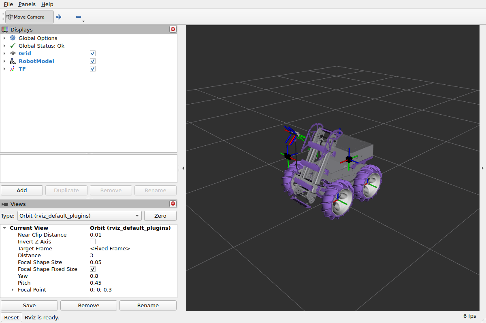

contains the URDF for NYU RDT's 2026 robot so that all can refer to one urdf and all changes can be made at once for all pkgs.



# Launching the URDF

Run everything inside the ROS container, from the workspace root.

## Build

```bash
cd ~/rdt26/rdt26-robot
colcon build --packages-select nyurdt_description nyurdt_navigation
source install/setup.bash
```

## Pick ONE joint publisher

The wheels are `continuous` joints. Their frames only exist while something
publishes `/joint_states`. If nothing does, RViz draws all four wheels piled
up at the origin. Run exactly one of the options below, never two at once.

### 1. Static model (no moving parts)

```bash
ros2 launch nyurdt_description rsp.launch.py
ros2 run joint_state_publisher joint_state_publisher   # second terminal
rviz2                                                  # third terminal
```

### 2. Interactive model (sliders spin the wheels)

```bash
ros2 launch nyurdt_description rsp.launch.py
ros2 run joint_state_publisher_gui joint_state_publisher_gui   # second terminal
rviz2                                                          # third terminal
```

If the GUI is missing: `apt install ros-jazzy-joint-state-publisher-gui`

### 3. Gazebo simulation (Gazebo publishes the joints)

```bash
ros2 launch nyurdt_navigation gazebo.launch.py
ros2 run teleop_twist_keyboard teleop_twist_keyboard   # second terminal, drive with i j k l
rviz2                                                  # optional, third terminal
```

Do not run `joint_state_publisher` here. Gazebo's JointStatePublisher plugin
already publishes the real wheel angles.

## RViz setup

1. Add > RobotModel, set Description Topic to `/robot_description`
2. Add > TF
3. Global Options > Fixed Frame: `base_link` (options 1 and 2) or `odom` (option 3)

## Updating the meshes from CAD

The meshes in `meshes/` come from the Fusion export. Run on a machine with
Blender, then copy `body.*`, `wheel.*` and `frames.txt` into `meshes/` and
paste the numbers from `frames.txt` into the properties at the top of
`urdf/robot.xacro`.

```bash
blender -b --python scripts/glb_to_meshes.py -- rover26.glb out_dir 100000 10000
```
